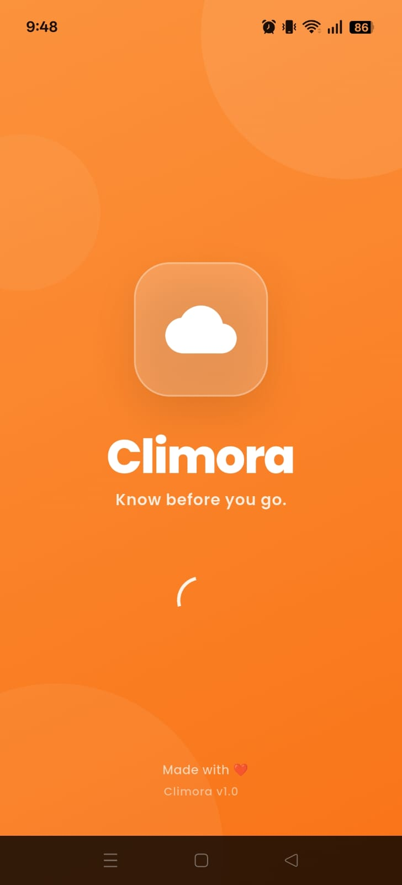
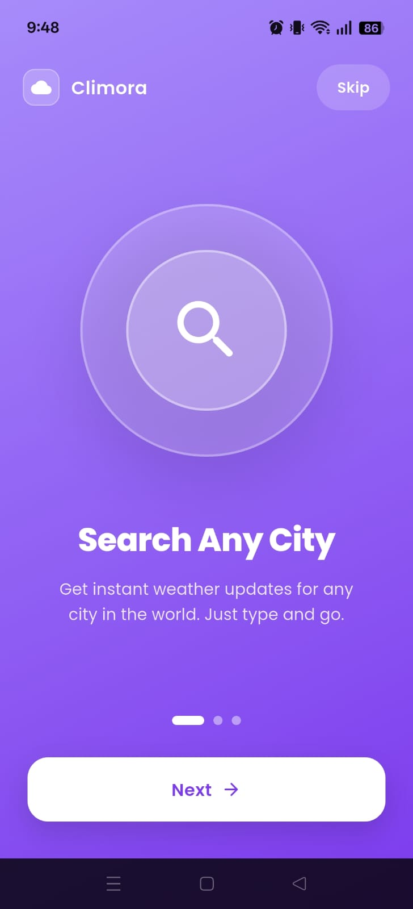
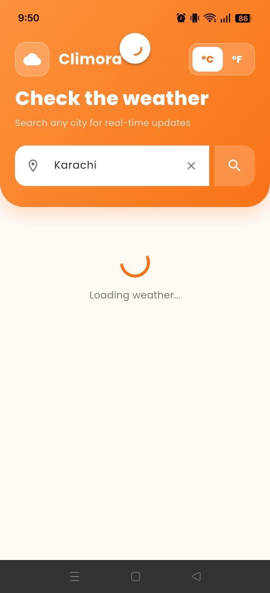
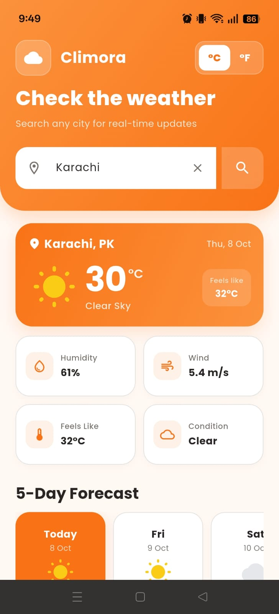
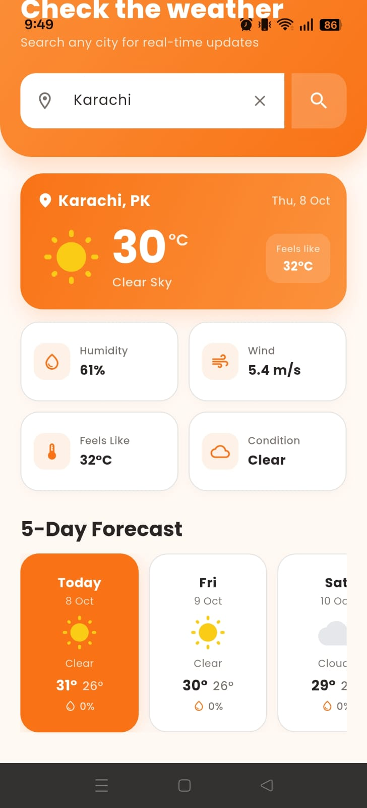
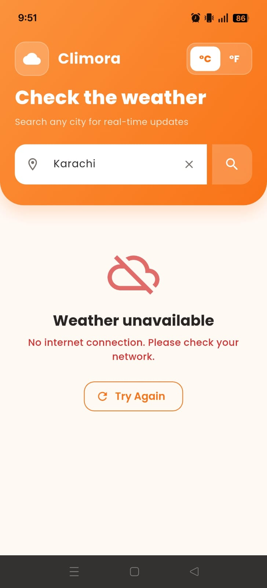

# Climora

A beautiful, modern Flutter-based weather application that provides live weather data, current conditions, and a 5-day forecast using the OpenWeatherMap API.

Climora is developed as part of **The Sky Gen App Development Project 02** and focuses on live API integration, state management, error handling, responsive UI, and a clean Flutter project structure.

---

## Overview

* Climora allows users to search for any city and view its current weather conditions along with a 5-day forecast.
* The application remembers the last searched city and automatically loads its weather when the app starts again.
* The app includes a branded animated splash screen and a 3-slide onboarding experience before entering the main weather dashboard.

---

## Features

* Live weather data using OpenWeatherMap API
* Branded animated splash screen
* 3-slide onboarding screens for first-time users with skip option
* Search weather by city name
* Celsius / Fahrenheit temperature toggle
* Remembers and automatically loads the last searched city
* Current temperature display
* Weather condition and description
* Feels-like temperature
* Humidity information
* Wind speed information
* 5-day weather forecast
* Rain probability for forecast days
* Pull-to-refresh weather data
* Loading state
* Invalid city error handling
* No internet / network error handling
* Retry functionality
* Responsive and scrollable UI
* Material 3 design
* Provider state management
* API key stored outside the source code using `.env`

---

## Screenshots

<table>
  <tr>
    <td align="center">
      <strong>Splash Screen</strong><br><br>
      
    </td>
    <td align="center">
      <strong>Onboarding</strong><br><br>
      
    </td>
    <td align="center">
      <strong>Loading State</strong><br><br>
      
    </td>
  </tr>

  <tr>
    <td align="center">
      <strong>Current Weather</strong><br><br>
      
    </td>
    <td align="center">
      <strong>5-Day Forecast</strong><br><br>
      
    </td>
    <td align="center">
      <strong>Network Error State</strong><br><br>
      
    </td>
  </tr>

  <tr>
    <td align="center">
      <strong>City Not Found Error State</strong><br><br>
      
    </td>
    <td></td>
    <td></td>
  </tr>
</table>


---

## Demo Video

A 60–90 second demo showcasing the main features, including city search, weather data, temperature unit switching, pull-to-refresh, and error handling.

[Watch Demo Video](https://drive.google.com/file/d/1hoxSWA9re1L2tTcsMx_GdQRoBrJqv8ce/view?usp=sharing)

---

## Tech Stack

| Technology         | Purpose                                |
| ------------------ | -------------------------------------- |
| Flutter            | Cross-platform application development |
| Dart               | Programming language                   |
| Provider           | State management                       |
| Dio                | HTTP/API requests                      |
| OpenWeatherMap API | Live weather data                      |
| SharedPreferences  | Last searched city persistence         |
| flutter_dotenv     | Local API key configuration            |
| Google Fonts       | Application typography                 |
| Intl               | Date formatting                        |
| Material 3         | UI design system                       |

---

## Project Structure

```text
lib/
├── core/
│   ├── constants/
│   │   └── api_constants.dart
│   ├── theme/
│   │   └── app_theme.dart
│   └── utils/
│       ├── date_formatter.dart
│       ├── temperature_formatter.dart
│       └── weather_icon_helper.dart
│
├── models/
│   ├── current_weather_model.dart
│   ├── daily_forecast_model.dart
│   └── forecast_model.dart
│
├── providers/
│   └── weather_provider.dart
│
├── services/
│   └── weather_api_service.dart
│
├── screens/
│   └── weather_screen.dart
│
├── widgets/
│   ├── weather_header.dart
│   ├── weather_search_bar.dart
│   ├── current_weather_card.dart
│   ├── weather_info_card.dart
│   ├── forecast_section.dart
│   ├── forecast_card.dart
│   ├── weather_state_view.dart
│   └── weather_error_view.dart
│
└── main.dart
```

---

## Architecture

Climora follows a simple layered architecture using Provider for state management.

```text
                        ┌──────────────────────────────────────────┐
                        │                UI LAYER                   │
                        │     Screens + Widgets (Presentation)      │
                        └──────────────────────────────────────────┘
                                            ↕
                        ┌──────────────────────────────────────────┐
                        │              STATE LAYER                 │
                        │       WeatherProvider (ChangeNotifier)   │
                        └──────────────────────────────────────────┘
                                            ↕
                        ┌──────────────────────────────────────────┐
                        │             SERVICE LAYER                │
                        │           WeatherApiService              │
                        └──────────────────────────────────────────┘
                                            ↕
                        ┌──────────────────────────────────────────┐
                        │              DATA LAYER                  │
                        │      Models + OpenWeatherMap API         │
                        │          + SharedPreferences             │
                        └──────────────────────────────────────────┘
```

---

## Get an API Key

Climora uses the OpenWeatherMap API for live weather data.

1. Create an account on OpenWeatherMap.
2. Open the API Keys section.
3. Copy your API key.
4. Add the key to the project's `.env` file.

---

## API Integration

Climora uses the **OpenWeatherMap API** to retrieve live weather information. Two API endpoints are used:

### Current Weather

```text
/data/2.5/weather
```

### 5-Day Forecast

```text
/data/2.5/forecast
```

Weather requests include:

* City name
* API key
* Metric temperature units

The application uses Dio for network communication and handles common API and network errors such as:

* Invalid API key
* City not found
* No internet connection
* Request timeout
* General API request failure

---

## API Key Setup

The API key is not hardcoded directly into the Dart source code.

Create a `.env` file in the project root:

```env
WEATHER_API_KEY=YOUR_ACTUAL_API_KEY
```

Make sure `.env` is included in `.gitignore`:

```text
.env
```

This prevents the local API key from being committed to the public GitHub repository.

### Important

Never add your real API key to the README or commit it to the public repository.

---

## Security

* The API key is stored in the local `.env` file instead of being hardcoded in the Dart source code.
* The `.env` file is excluded from Git using `.gitignore` to prevent the API key from being committed to the public repository.
* For a client-side Flutter application, the API key can still be present in the built application. The `.env` approach is used here primarily to keep the key out of the public source repository.

---

## Installation

Install the project dependencies:

```bash
flutter pub get
```

Run the application:

```bash
flutter run
```

---

## Environment Configuration

The application loads the API key using `flutter_dotenv`.

Example:

```dart
final apiKey = dotenv.env['WEATHER_API_KEY'];
```

The API key is then passed to OpenWeatherMap through the API request.

---

## State Management

Climora uses **Provider** with `ChangeNotifier` for application state management.

The weather provider manages:

* Initial state
* Loading state
* Success state
* Error state
* Current weather data
* Forecast data
* Celsius/Fahrenheit selection
* Temperature conversion
* Last searched city persistence

The UI automatically updates when the provider state changes.

---

## Local Data Persistence

Climora uses **SharedPreferences** to store the last successfully searched city.

When the application starts:

1. The saved city is retrieved.
2. The city name is placed in the search field.
3. Weather data is requested automatically.
4. The latest weather information is displayed.

This allows users to continue from their previously searched city when reopening the application.

---

## Error Handling

The application provides dedicated handling for different failure scenarios.

### Invalid City

```text
City not found.
```

### No Internet

```text
No internet connection. Please check your network.
```

### Invalid API Key

```text
Invalid weather API key.
```

### Request Timeout

```text
Request timed out. Please try again.
```

Users can use the **Try Again** button to retry the weather request.

---

## Temperature Units

Users can switch between:

* Celsius (°C)
* Fahrenheit (°F)

Temperature conversion is handled locally by the weather provider without making another API request.

The selected unit is applied to:

* Current temperature
* Feels-like temperature
* Forecast maximum temperature
* Forecast minimum temperature

---

## Testing

The application was manually tested for the following scenarios:

* App launch
* Splash screen
* Onboarding screens
* Last searched city loading
* City search
* Current weather data
* 5-day forecast
* Celsius/Fahrenheit conversion
* Pull-to-refresh
* Invalid city handling
* No internet handling
* Retry functionality
* Long city names
* Responsive UI
* Forecast scrolling
* No UI overflow
* Flutter analyzer validation

Flutter analyzer result:

```text
No issues found!
```

---

## Build Release APK

To generate a release APK:

```bash
flutter build apk --release
```

Generated APK:

```text
build/app/outputs/flutter-apk/app-release.apk
```

---

## Project Links & Submission
**GitHub Repository:** [Climora Github Repository](https://github.com/Atif798/climora)
**Google Drive Submission Folder:** [Climora Submission Folder](https://drive.google.com/drive/folders/1yJ6yiVlJlV1FGKkWEOajXcaGzeX-0Ms?usp=drive_link)
**Demo Video:** [Climora Demo Video](https://drive.google.com/file/d/1hoxSWA9re1L2tTcsMx_GdQRoBrJqv8ce/view?usp=sharing)
---

## Developed By

**Developed By:** Atif Shehzad
